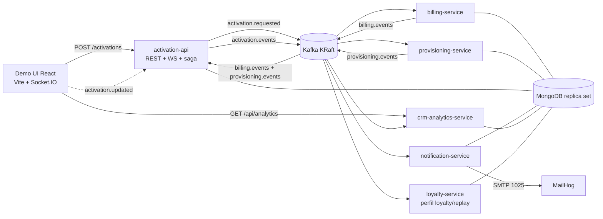

# POC Activación de Servicios con Kafka

**Ingeniería en Sistemas de Información · Sistemas Distribuidos 2026**  
*Facultad de Ciencia y Tecnología (FCyT) - Sede Concepción del Uruguay - UADER*

Documento de arquitectura e implementación de la POC de activación de planes mediante eventos distribuidos con **Apache Kafka**, **NestJS** y **React**.

---

## 01 Resumen

La POC demuestra que la activación de un plan de telecomunicaciones puede resolverse publicando un único evento en Kafka, sin que ningún servicio llame directamente a otro. Un cliente contrata un plan desde una UI en React; eso dispara facturación, aprovisionamiento, notificación y registro en CRM, coordinados por eventos.

---

## 02 Arquitectura



### Componentes y Servicios

| Componente | Puerto | Base Mongo | Rol / Responsabilidad |
| --- | ---: | --- | --- |
| `demo-ui` | 5173 | — | Formulario "Contratar plan", timeline de eventos en vivo por WebSocket y métricas. |
| `activation-api` | 3000 | `poc_activation` | REST (`/activations`), WebSocket y agregador de la saga. Decide si la activación finaliza `ACTIVE` o `FAILED`. |
| `billing-service` | — | `poc_billing` | Crea la cuenta de facturación simulada. Consume `ActivationFailed` para compensación. |
| `provisioning-service` | — | `poc_provisioning` | Aprovisiona la línea con retardo simétrico (1 a 3s). Puede fallar a pedido. |
| `notification-service` | — | `poc_notifications` | Consume `activation.events` y despacha emails a MailHog. |
| `crm-analytics-service`| 3004 | `poc_crm_analytics`| Consume todos los topics y expone analítica e histórico. |
| `loyalty-service` | 3005 | `poc_loyalty` | Consumidor opcional con perfil `loyalty` para demostrar replay del log histórico. |
| **Kafka (KRaft)** | 29092 / 9092 | — | Broker único sin ZooKeeper con 4 topics particionados y sus DLQ. |
| **Kafka UI** | 8080 | — | Monitoreo visual de topics, mensajes, particiones y consumer lag. |
| **MailHog** | 8025 / 1025 | — | Servidor SMTP simulado con webmail en vivo. |
| **MongoDB** | 27017 | `rs0` | Replica set de 1 nodo (necesario para transacciones multi-documento y outbox). |

---

## 03 Topics y Contratos de Eventos

Todos los topics tienen **3 particiones**, retención de **7 días** y clave de partición `customerId` para garantizar orden estricto por cliente.

| Topic | Eventos | Productor | Consumidores |
| --- | --- | --- | --- |
| `activation.requested` | `ActivationRequested` | `activation-api` | `billing-service`, `provisioning-service`, `crm-analytics-service` |
| `billing.events` | `BillingAccountCreated`, `BillingFailed`, `BillingAccountCancelled` | `billing-service` | `activation-api`, `crm-analytics-service` |
| `provisioning.events`| `ProvisioningCompleted`, `ProvisioningFailed` | `provisioning-service` | `activation-api`, `crm-analytics-service` |
| `activation.events` | `ActivationCompleted`, `ActivationFailed` | `activation-api` | `notification-service`, `billing-service`, `crm-analytics-service`, `loyalty-service` |
| `<topic>.dlq` | Mensajes con 3 fallos consecutivos | Consumidor que falló | Inspección manual en Kafka UI |

Los contratos de eventos residen en la librería compartida [`libs/contracts`](libs/contracts).

---

## 04 Decisiones Técnicas Implementadas

1. **Idempotencia en cada consumidor**: Inserción atómica en `processed_events` con índice único por `eventId` y TTL de 7 días.
2. **Reintentos y DLQ**: 3 reintentos con backoff exponencial (1s, 2s, 4s). Al superar los reintentos, el mensaje se envía a `<topic>.dlq` con headers de causa de error para no bloquear la partición.
3. **Outbox transaccional**: El estado del servicio y el evento a publicar se graban en la misma transacción Mongo; un poller asíncrono (`OutboxRelay`) publica a Kafka cada 500 ms.
4. **Commit manual**: Se confirma el offset en Kafka únicamente después del procesamiento exitoso o del enrutamiento a la DLQ.

---

## 05 Puesta en Marcha Rápida

### Requisitos
- Docker Desktop con Docker Compose v2.
- Node.js 20+ (para desarrollo local y tests).

### Levantar todo el entorno con Docker Compose

```powershell
docker compose up -d --build
docker compose ps
```

### URLs de acceso

| Herramienta | URL |
| --- | --- |
| Demo UI (Consola React) | http://localhost:5173 |
| Kafka UI | http://localhost:8080 |
| MailHog (Webmail) | http://localhost:8025 |
| Health `activation-api` | http://localhost:3000/health |
| Health `crm-analytics` | http://localhost:3004/health |

---

## 06 Pruebas y Smoke Test

### Tests unitarios de la Saga
Prueban el reductor de estados puro de `activation-api` (camino feliz, fallo en billing, fallo en provisioning, compensación y tolerancia a eventos tardíos):

```powershell
npm test
```

### Smoke Test de integración
Ejecuta de punta a punta un camino feliz y los dos escenarios de fallo contra el entorno Dockerizado, comprobando la compensación y la traza en CRM:

```powershell
npm run smoke
```

### Creación manual por CLI

```powershell
# Alta feliz:
node scripts/create-activation.mjs --customer C-1001 --plan PLAN_DIGITAL

# Alta con fallo en provisioning:
node scripts/create-activation.mjs --customer C-1002 --failure provisioning

# Alta con fallo en billing:
node scripts/create-activation.mjs --customer C-1003 --failure billing
```

---

## 07 Guion de la Demo

El paso a paso de los 5 escenarios para la defensa se encuentra en [docs/demo-script.md](docs/demo-script.md):
1. **Camino feliz** (Demuestra Fan-out).
2. **Fallo y compensación** (Demuestra Saga por coreografía).
3. **Servicio caído** (Demuestra Offset y retención).
4. **Escalar horizontalmente** (Demuestra rebalanceo de particiones en consumer group).
5. **Nuevo consumidor** (Demuestra Replay del log histórico con `loyalty-service`).
