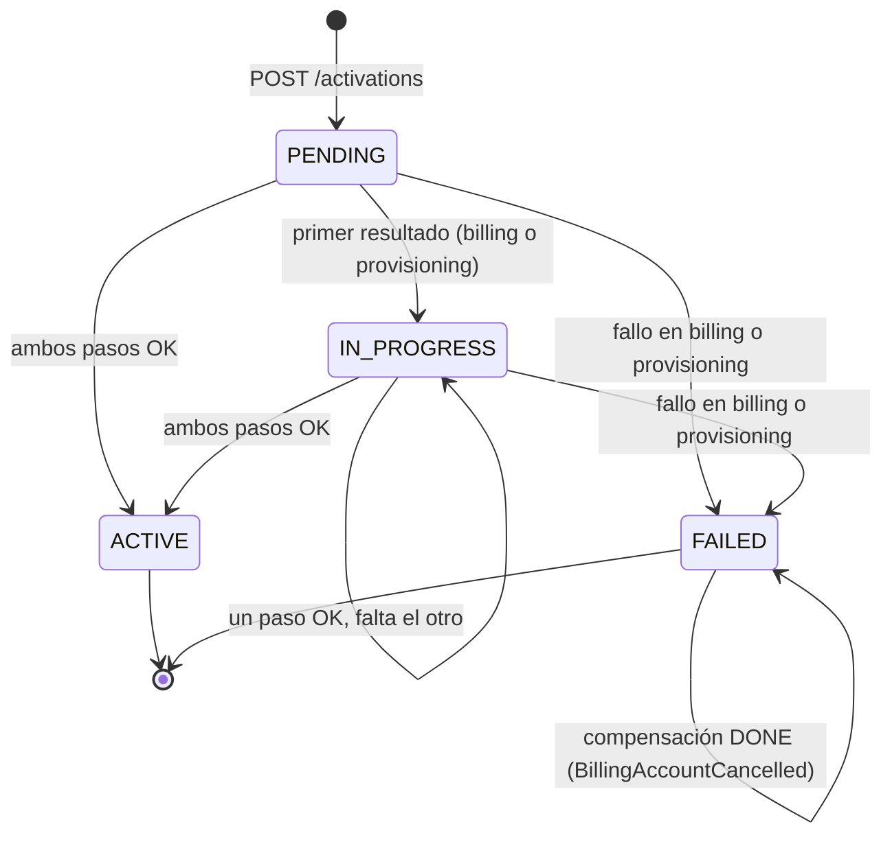
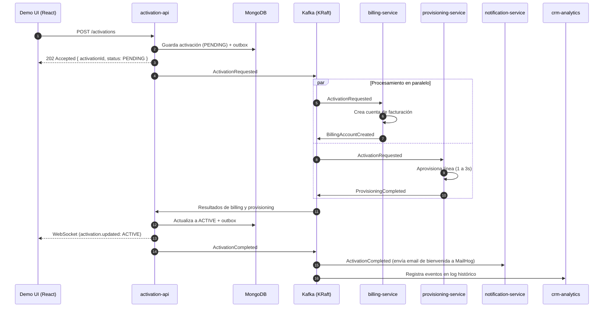

# Arquitectura y decisiones de diseño

Documento de arquitectura de la **POC de Activación de Servicios con Kafka** (FCyT Sede Concepción del Uruguay - Sistemas Distribuidos 2026).

Explica cómo funciona la POC por dentro: límites de servicios, flujo de la saga orquestada por eventos, garantías de entrega, transacciones en MongoDB con outbox, compensación y los 5 escenarios de demo.

---

## 1. Resumen y Alcance

La POC demuestra que la activación de un plan puede resolverse publicando un único evento en Kafka, sin que ningún servicio llame directamente a otro. Un cliente contrata un plan desde una UI en React; eso dispara facturación, aprovisionamiento, notificación y registro en CRM, coordinados por eventos.

### Incluido
- UI de demo con formulario de contratación y timeline de eventos en vivo por WebSocket.
- Cinco servicios NestJS: `activation-api`, `billing-service`, `provisioning-service`, `notification-service` y `crm-analytics-service`.
- Kafka de un broker en modo KRaft, Kafka UI y MongoDB en replica set (para transacciones multi-documento).
- Fallos forzados desde la UI, compensación, idempotencia, reintentos y DLQ (Dead Letter Queue).
- Guión de demo con cinco escenarios (+ consumidor adicional `loyalty-service` para demostrar Replay).

### Fuera de alcance
- Integración con BSS, checkout o proveedores reales.
- Autenticación y autorización de usuarios.
- Alta disponibilidad con múltiples brokers en la nube.
- Pruebas de carga y métricas de rendimiento.
- Schema Registry y trazas distribuidas (fase opcional).

---

## 2. Límites de servicios

| Servicio | Estado que posee | Eventos que produce | Eventos que consume |
| --- | --- | --- | --- |
| `activation-api` | `activations` | `ActivationRequested`, `ActivationCompleted`, `ActivationFailed` | `BillingAccountCreated`, `BillingFailed`, `BillingAccountCancelled`, `ProvisioningCompleted`, `ProvisioningFailed` |
| `billing-service` | `billing_accounts`, `outbox` | `BillingAccountCreated`, `BillingFailed`, `BillingAccountCancelled` | `ActivationRequested`, `ActivationFailed` |
| `provisioning-service` | `provisioning_orders`, `outbox` | `ProvisioningCompleted`, `ProvisioningFailed` | `ActivationRequested`, `ActivationFailed` |
| `notification-service` | `notifications` | — | `ActivationCompleted`, `ActivationFailed` |
| `crm-analytics-service` | `event_log` | — | Todos los topics de negocio (`activation.requested`, `billing.events`, `provisioning.events`, `activation.events`) |
| `loyalty-service` | `loyalty_members` | — | `activation.events` (con group nuevo y `fromBeginning: true`) |

Cada servicio cuenta con su propia base en MongoDB (`MONGO_DB`) y sus propias colecciones `processed_events` y `outbox`.

---

## 3. Máquina de estados de la saga

El reducer puro está en [`apps/activation-api/src/activation/activation-state.ts`](../apps/activation-api/src/activation/activation-state.ts) y se prueba unitariamente con `activation-state.test.ts`.

### Reglas de agregación:
1. `ACTIVE` solo se alcanza cuando **ambos** servicios (`billing` y `provisioning`) confirman `OK`.
2. Si cualquiera de los dos falla, la activación pasa inmediatamente a `FAILED`, se publica `ActivationFailed` y se ignora el resultado posterior del otro servicio (salvo para registrarlo en el historial).
3. Si `billing` había creado la cuenta antes de ver el fallo de `provisioning`, consume `ActivationFailed` y genera `BillingAccountCancelled` (compensación).

---

## 4. Secuencia de la activación

### Camino feliz

---

## 5. Decisiones Técnicas

1. **Idempotencia en cada consumidor**: Inserción atómica del `eventId` en la colección `processed_events` con índice único y TTL de 7 días. Si llega duplicado, se descarta y se comitea el offset.
2. **Reintentos y Dead Letter Queue (DLQ)**: Ante error técnico, 3 reintentos con backoff exponencial (1s, 2s, 4s). Al tercer fallo se publica a `<topic>.dlq` con headers de error y se continúa. Los errores de negocio (`simulateFailure`) emiten eventos tipados de fallo y no van a la DLQ.
3. **Outbox transaccional**: Para evitar pérdida de eventos o dual-write inconsistente, el cambio de estado y el evento se guardan en la misma transacción Mongo; un poller asíncrono lee y despacha a Kafka.
4. **Partición por cliente**: La partition key es `customerId`, asegurando orden estricto para eventos del mismo cliente dentro de la misma partición.
